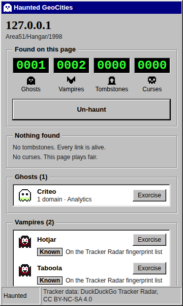
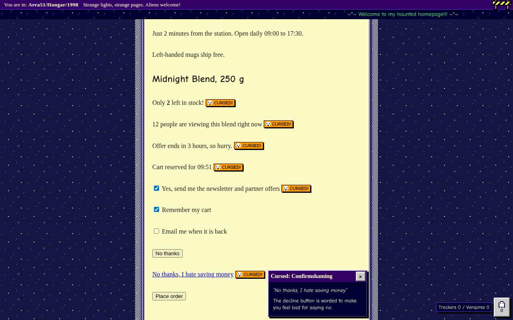
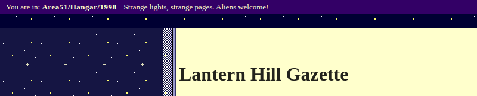

# Haunted GeoCities

A Chrome extension (Manifest V3) that turns the page you are on into a 1998 GeoCities crypt. Click **Haunt** and the page gets a night sky, a heads-up display and a marquee. Click **Un-haunt** and the page is put back as it was. It is an entry in Kiroween 2026, Costume Contest.

A pre-period prototype exists outside the entry and was rebuilt from lessons, not copied; Tracker Radar ingest output is the only reused data.


## What it does

- Haunt and un-haunt any page from the toolbar popup. The costume (starfield, HUD, marquee) sits in a closed shadow root over the page, and un-haunting removes it.
- Trackers show up as ghosts, one per company, matched against the bundled DuckDuckGo Tracker Radar data. Click a ghost for its card.
- Exorcise blocks a company for the current tab with declarativeNetRequest session rules. The block lasts until you un-haunt, reload or leave the page, or close the tab, and the popup can let it back in.
- Scripts caught fingerprinting at runtime (canvas, audio or font probing) become vampires. Companies that Tracker Radar already rates as fingerprinters are listed as known vampires.
- Dead links get a tombstone beside them. The extension sends a HEAD request, and a 404 or 410 answer makes a tombstone. Clicking one opens a stone card with the path and the status.
- Dark patterns get a CURSED! badge beside them: fake scarcity ("Only 2 left"), countdown text, ticking timers, confirmshaming and pre-checked opt-in boxes. Clicking a badge opens a card that quotes the page's own words and names the trick. The pre-checked box is only labelled, never unticked.
- Every site gets a GeoCities neighborhood address, such as `SiliconValley/Heights/2049`, worked out from its host name. The bar at the top shows it with the neighborhood's tagline, and the popup shows it under the site title.
- The popup lists the ghosts, vampires, tombstones and curses found on the page.
- While a page is haunted, the toolbar icon shows how many ghosts, vampires, tombstones and curses that tab has.








## Load it

You need [bun](https://bun.sh) and Chrome.

```
bun install
bun run build
```

Open `chrome://extensions`, turn on Developer mode, choose **Load unpacked** and pick the `dist/` folder.

The test build is `dist.zip`, attached to the GitHub release. Unzip it into an empty folder and load that folder with **Load unpacked**. To make the same zip yourself, run `bun run package`. It builds and writes `dist.zip` at the repo root with `manifest.json` at the top of the zip.

Open a page and click the toolbar icon, then **Haunt this page**.

## Fixtures walkthrough

The fixture pages are small made-up sites in `fixtures/`. Start the server:

```
bun run fixtures
```

It serves them on `http://127.0.0.1:4321` (`scripts/fixture-server.ts`, an optional port can be passed as an argument).

| Page | What it shows |
| --- | --- |
| `index.html` | A plain newspaper page with a form and links. Haunt it and un-haunt it. |
| `clean.html` | A quiet page with no trackers. |
| `column.html` | A long article, good for seeing the costume around a page. |
| `trackers.html` | Ghosts (Criteo), plus Hotjar and Taboola as known vampires. Try Exorcise on the card or in the popup. |
| `vampires.html` | Two scripts that fingerprint the visitor when you click into the email field. After that they show up as caught vampires. |
| `links.html` | Three dead links (404, 410 and a long path) that get tombstones. |
| `dark-patterns.html` | A fake coffee shop cart with low-stock lines, an offer countdown, a ticking clock, a pre-checked newsletter box and a shaming decline link. Haunt it for six curses. |
| `forms.html` | Page scripts and a form that haunting must leave alone. |

The tracker and vampire pages load scripts from real tracker domains. Chrome has to send those names to the local server, so start a separate Chrome with a host-resolver flag, and load the extension in that one:

```
google-chrome --user-data-dir=/tmp/hg-profile --host-resolver-rules="MAP criteo.com 127.0.0.1,MAP hotjar.com 127.0.0.1,MAP taboola.com 127.0.0.1,MAP adentifi.com 127.0.0.1,MAP nightowl-metrics.test 127.0.0.1"
```

`index.html`, `clean.html`, `column.html`, `links.html`, `dark-patterns.html` and `forms.html` work in any Chrome. The tracker and vampire pages need the flag, because otherwise the tracker hosts do not resolve and nothing is seen.

## Permissions

From `src/manifest.ts`:

- `activeTab`: lets the popup act on the tab you clicked in, and only that tab.
- `scripting`: injects the costume script into that tab when you click Haunt.
- `declarativeNetRequest`: Exorcise, which blocks a tracker company's domains for one tab.
- `storage`: keeps per-tab state for the session and the sound setting.
- Optional `http://*/*` and `https://*/*`: asked for only if you switch on "Check links to other sites" in the popup. That opens a small extension page, `permissions.html`, in a new tab, and you allow it there, because Chrome's permission prompt would close the popup. Without it, only links on the same site are checked. You can turn it off again in the popup, which removes the permission.

There are no host permissions at install.

Privacy: link checks are sent with no cookies (`credentials: "omit"`). Nothing leaves the browser beyond those link checks. The tracker data is bundled in the extension and matched locally.

## Tracker Radar data and licence

The code is MIT (see [LICENSE](LICENSE)). The bundled `src/data/trackers.json` is derived from the DuckDuckGo Tracker Radar and is licensed CC BY-NC-SA 4.0, not MIT. If you reuse that data you have to keep the attribution, stay non-commercial and share it alike. See [src/data/ATTRIBUTION.md](src/data/ATTRIBUTION.md) and [src/data/LICENSE-tracker-radar.txt](src/data/LICENSE-tracker-radar.txt). The licence does not cover DuckDuckGo logos or marks.

## Notes

- The costume uses Comic Sans. On Linux it is usually not installed, so the browser falls back to another font.

## Checks

```
bun run typecheck
bun run test
bun run test:e2e
bun run lint:manifest
bun run test:visual
bun run docker:test
```

`test:e2e` launches headless Chromium with a build of the extension that also has host permissions for localhost (`dist-e2e/`), because Playwright cannot click the toolbar icon. `dist/`, the build you ship, has none. `docker:test` builds the Dockerfile, which runs the typecheck, the unit tests, the manifest lint, the e2e run and the visual check in a clean Playwright image.

The screenshots above are taken from the real extension on the fixtures by `bun run screenshots`, which is kept out of `test:e2e`.

### lint:manifest

`bun run lint:manifest` builds `dist/` and checks the shipping manifest, both the object `src/manifest.ts` returns and the `dist/manifest.json` the build wrote. It checks that the manifest is MV3, loads no remote code, has exactly the four permissions listed above, has no `host_permissions` or `optional_permissions`, offers only `http://*/*` and `https://*/*` as optional hosts and has no `'unsafe-eval'` in its CSP. It also checks that every file the manifest names is in `dist/`, and that every script and stylesheet the built HTML pages load is there too. It prints `lint:manifest: ok`, or one line per problem with its rule name and exits with code 1. The e2e build is not linted, because it has host permissions on purpose.

### test:visual

`bun run test:visual` builds the e2e extension and takes screenshots of the haunted costume on `index.html`, `trackers.html`, `links.html`, `dark-patterns.html` and `column.html`, and of the popup before and after haunting, each at 1280 and 375 pixels wide. Motion is reduced, animations are stopped and the page clock is fixed, so a shot comes out the same on every run. Each shot is compared with its baseline in `e2e-visual/__screenshots__/`. If one differs, the run fails and the expected, actual and diff images are written to `test-results/`. A missing baseline also fails the run.

When you change how the costume or the popup looks on purpose, update the baselines in the same commit and look at the new PNGs before committing them. The baselines are made in the Playwright Docker image the Dockerfile uses, because fonts differ between machines (Comic Sans is usually missing on Linux and the fallback varies), and the shots are compared at a tight tolerance:

```
bun run visual:baselines
```

That runs `bun run test:visual:update` inside the image and copies the PNGs out. The authoritative check is `bun run docker:test`, which runs `test:visual` in the same image against the committed baselines; `bun run test:visual` on your own machine can fail on font differences alone. Running `bun run test:visual:update` directly writes baselines from your own machine's fonts, which is only useful for trying things out.

## Kiro hooks

Three Kiro IDE hooks live in `.kiro/hooks/`. Kiro IDE runs a hook when you save a file that matches it. They are a quick local check while you work, not a replacement for the checks above.

| Hook | Runs when you save | What it does |
| --- | --- | --- |
| `manifest-lint` | `src/manifest.ts` or `vite.config.ts` | Runs `bun run lint:manifest`. |
| `visual-regression` | a file in `src/content/costume/` or `src/popup/`, or `design/DESIGN.md` | Runs `bun run test:visual`. |
| `era-accuracy` | a file in `src/content/costume/` | Asks the agent to review the edit against `.kiro/steering/era-accuracy.md`: web-safe colours only, Comic Sans MS and Times New Roman only, original pixel art, nothing a 1998 GeoCities page would not have had, and no trademarks. It reports each problem with its file and line, and does not change any file. |

A costume edit sets off both `visual-regression` and `era-accuracy`. The screenshot run takes a little while because it builds the extension and starts Chromium.

To turn a hook off, set `"enabled": false` in its file, or switch it off in the Kiro hooks panel. `test/hooks.test.ts` checks every hook file: the fields Kiro needs, that each command is a `bun run` script that exists in `package.json`, and that each pattern points at a path that exists.

## How Kiro was used

The `.kiro/` folder holds what kiro-cli generated for this project: steering files in `.kiro/steering/` (product, structure, tech, era accuracy, accessibility and motion, non-destructive DOM) and specs in `.kiro/specs/` for the scaffold, tracker detector, costume renderer, tombstones, runtime vampires, dark-pattern curses (`dark-patterns`) and neighborhoods. Each spec has requirements, a design and a task list.

The three hooks in `.kiro/hooks/` were also written by kiro-cli, together with their spec in `.kiro/specs/kiro-hooks/` (`kiro-hooks`), which covers the hook files, `lint:manifest`, `test:visual` and the test that checks the hooks.