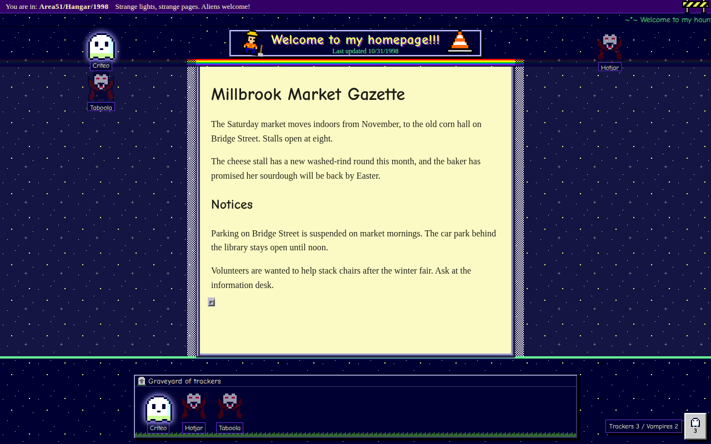
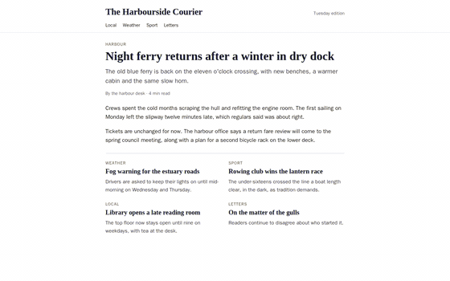
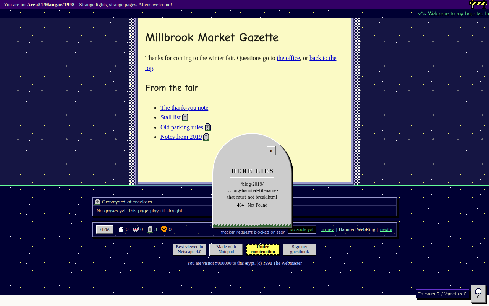

# Haunted GeoCities


A pre-period prototype exists outside the entry and was rebuilt from lessons, not copied; Tracker Radar ingest output is the only reused data.

[](https://github.com/chrisbuildsonline/haunted-geocities/actions/workflows/ci.yml)

A Chrome extension (Manifest V3) that turns the page you are on into a 1998 GeoCities crypt. Click **Haunt** and the page itself turns 1998, and every site gets its own look: a tiled background (flames, bricks, clouds, green code rain, slime, starfield), a welcome banner with pixel sprites, old web fonts, WordArt or rainbow headings, a tinted column in a bevelled frame, a marquee and a cursor trail. Click **Un-haunt** and the page is put back as it was. It is an entry in Kiroween 2026, Costume Contest.

The GIF at the top is a real page, not a fixture: the shipping build on the live National Park Service home page (`https://www.nps.gov/index.htm`) over the real network, made on 2026-11-27 by `bun run docs:realsite`. Playwright cannot click the toolbar icon, so the run gives the extension a host permission for that one site in place of the click, then presses **Haunt page** in the popup (the run answers no to the site prompt, so it haunts that one page). The parade carries the trackers the page really loaded, and the caption reads `Trackers found: 4` while their four name tags are still on screen ([still](docs/real-site-caption-nps.png)). The same run on the CDC home page (`https://www.cdc.gov/`) shows `Trackers found: 3` ([still](docs/real-site-caption-cdc.png)). Both are US government pages, public-domain works, and the extension has no link to either agency. The record of the run is [`docs/real-site.json`](docs/real-site.json). Live pages change, so this run is a docs tool and not one of the checks. Every other shot and GIF in this README, and the opening of the demo video, uses the fixture pages in `fixtures/`, small made-up sites served locally (with real tracker domains pointed at the local server), not real sites.



## What it does

- Haunting is a three-second show: the page switches off like an old CRT (scanlines, the picture closes to a bright line, then a dot), the Webmaster's Ghost flies across and leaves 1998 behind it while six big ghosts stream up through the whole page, and then the tracker ghosts rise out of the page one by one, each with its company's name tag. The six big ghosts are the page's own tracker companies, each wearing its name on its hem; only a page with fewer than six gets plain decorative ghosts to make up the six. On a phone they ride the marquee band under the address bar instead, so they never cover the text or the address. A `Trackers found: N` caption rides into the marquee band and stays there for over a second, off the page's text. A click or any key skips the show, and the page settles at once. With reduced motion on, it skips straight to the haunted page.
- Haunt and un-haunt any page from the toolbar popup. The page is restyled (fonts, link colours, a parchment tint and a guestbook frame around the content column) by one adopted stylesheet, and the starfield and marquee sit in a closed shadow root over it. On a phone or a full-width page the whole page is tinted inside a 12px starfield edge. On photo-heavy sites the dark hero panels and bands become bevelled crypt windows with light-blue links, text set straight on a photo gets a crypt window drawn round it, outline buttons become raised 1998 buttons, and search boxes become sunken 1998 fields. Nothing floats over the page's end: the page gets a 1998 footer of its own, in normal flow after it, with the graveyard of trackers, the hit counter, the web ring, four 88x31 badges (`Best viewed in Netscape 4.0` and friends) and a visitor-number sign-off. The one fixed thing at the bottom is a small ghost icon in the bottom-right corner: it shows how many trackers still haunt the page, and a click jumps to the footer graveyard. Beside it one line (`Trackers 6 / Vampires 2`) keeps the findings on the first screen until the footer's own counts scroll into view. Un-haunting removes it all and the page is byte for byte as it was.
- One button, **Haunt page**, and the haunt follows you around the site. The click asks Chrome once for access to that one site, such as `nps.gov` and its subdomains (a short line under the button says so). Allow it, and every page of that site you open in the same tab, or reload, is haunted too, straight away and without the three-second show, while the popup says `Haunting all of nps.gov`. While each next page loads, a 1998 loading screen (a ghost, `Loading crypt…` and a Win95 progress bar) covers it from before its first paint until the costume is on, so the plain page never flashes; it lifts after 3 seconds at most. Going to another site, Un-haunt or closing the tab ends it. Say no and only the page you are on is haunted.
- Trackers show up as ghosts, one per company, matched against the bundled DuckDuckGo Tracker Radar data. Click a ghost for its card. Every company also stands in the footer graveyard at the end of the page, in rows that wrap; on a phone or a full-width page, where there is no room beside the text, the footer is where they are. Their name tags take two or three lines when they need to, so `Google Analytics` and `Google Ads` never read as the same cut-off name and `U.S. General Services Administration` reads whole.
- The HUD hit counter is labelled `Souls counted`: the number of tracker requests blocked or seen on the page.
- Exorcise blocks a company for the current tab with declarativeNetRequest session rules. Its ghost spirals out to a faded look as an EXORCISED stamp slams on, and the HUD count of ghosts still haunting the page ticks down. The block lasts until you un-haunt, reload or leave the page, or close the tab, and the popup can let it back in.
- Scripts caught fingerprinting at runtime (canvas, audio or font probing) become vampires. Companies that Tracker Radar already rates as fingerprinters are listed as known vampires.
- Dead links get a tombstone beside them. The extension sends a HEAD request, and a 404 or 410 answer makes a tombstone. Clicking one opens a stone card with the path and the status.
- Dark patterns get a CURSED! badge beside them: fake scarcity ("Only 2 left"), countdown text, ticking timers, confirmshaming and pre-checked opt-in boxes. Clicking a badge opens a card that quotes the page's own words and names the trick. The pre-checked box is only labelled, never unticked.
- Every site gets a GeoCities neighborhood address, such as `SiliconValley/Heights/2049`, worked out from its host name. The bar at the top shows it with the neighborhood's tagline, and the popup shows it under the site title.
- The popup is dressed for the same year as the page: a Windows 95 window with a navy title bar, bevelled buttons, green-on-black hit counters, checkboxes and a status bar. It lists the ghosts, vampires, tombstones and curses found on the page.
- While a page is haunted, the toolbar icon shows how many ghosts, vampires, tombstones and curses that tab has.
- Sound is off by default. Turn on **Sound effects** in the popup and the Haunt click plays a short whoosh, and opening a card plays a short sound for its kind: a soft "ooo" for a ghost, a stone thud for a tombstone, a sting for a curse and an organ stab for a vampire. The sounds are made in code with the Web Audio API (`src/audio/sound.ts`), with no audio files, and nothing plays until you click.







## Themes

Each site wears its own 1998 homepage. The host name, with `www.` dropped, seeds a small random number generator (FNV-1a into mulberry32), so a site looks the same on every page and every reload, and two sites almost never match.

The seed picks one of 22 named presets, such as Flame Skull Shrine, Cloud Angel Page, Matrix Hacker Den or Under Construction Zone, then swaps two or three of its parts for others: the palette, the page layout, how busy the page is, how sections are boxed, the `<hr>` divider (flames, skulls, construction tape, rainbow, slime), the sprite pair (spinning skull, flapping bat, construction worker, mailbox, UFO, globe and more), the frame bevel, the banner wording, the hit counter colours and the cursor trail.

The layout changes the page itself. Its body is squeezed into a 640 or 800 pixel table, pushed to the left, or put next to a nav frame on the left, a Cool Links column on the right, or both. The furniture around it is built from the page's own links and headings: nav buttons, Cool Links, a What's New box, award ribbons, an under-construction sign, a guestbook mailbox, a visitor counter, a webring box and a tab bar. Its sections become bevelled cells or boxes with a legend, lists get pixel bullets, and headings get a little skull, flame or star. A quiet site gets one big banner over a plain table; a busy one gets three columns of stuff. On a phone it all folds into one column with the furniture at the bottom. None of the page's own nodes are changed, and Un-haunt still puts the page back byte for byte. A short list of rules keeps out pairs that clash, like flames on a pink ground, and a unit test walks every preset with every swap and checks the text contrast. Classic Crypt keeps the original starfield and parchment look.

Two real pages from the same run: nps.gov ([still](docs/real-site-caption-nps.png)) and cdc.gov ([still](docs/real-site-caption-cdc.png)) get different looks. The e2e build alone accepts `?hgtheme=<preset>` in the page address, so the visual tests can show a chosen preset.

## Secrets

Four small surprises, only on a haunted page (they go with Un-haunt and never touch the page's own markup), and never while you type into a field:

- **Konami code** (`↑ ↑ ↓ ↓ ← → ← → B A`): three seconds of full haunt, every ghost bobbing three times faster and `!!! FULL HAUNT !!!` on the marquee.
- **Click the hit counter 13 times** (each click within 3 seconds of the last): a pixel skeleton dances beside it for 5 seconds.
- **Type `boo`**: every ghost and vampire flees off the bottom of the screen and floats back 2 seconds later.
- **Midnight and Halloween**: between 00:00 and 00:59 local time the marquee opens with `It's the witching hour.`, and all day on October 31 with `Happy Halloween from 1998!`, with the address bar in pumpkin orange.

With reduced motion on, the frenzy is only its marquee line, the skeleton stands still and the ghosts fade instead of flying.

## Load it

You need [bun](https://bun.sh) and Chrome.

```
bun install
bun run build
```

Open `chrome://extensions`, turn on Developer mode, choose **Load unpacked** and pick the `dist/` folder.

The test build is `dist.zip`, attached to the GitHub release. Unzip it into an empty folder and load that folder with **Load unpacked**. To make the same zip yourself, run `bun run package`. It builds and writes `dist.zip` at the repo root with `manifest.json` at the top of the zip.

Open a page and click the toolbar icon, then **Haunt page**. Allow the site when Chrome asks to keep every page of that site haunted in the tab.

## Fixtures walkthrough

The fixture pages are small made-up sites in `fixtures/`. Start the server:

```
bun run fixtures
```

It serves them on `http://127.0.0.1:4321` (`scripts/fixture-server.ts`, an optional port can be passed as an argument).

| Page | What it shows |
| --- | --- |
| `index.html` | A plain newspaper page with a form and links. Haunt it and un-haunt it. |
| `clean.html` | A quiet page with no trackers. |
| `column.html` | A long article, good for seeing the costume around a page. |
| `article.html` | A plain white article with code, an icon and a form: the restyle, the tint and the guestbook frame. |
| `dark.html` | A dark page: no tint, light-blue links. |
| `trackers.html` | Ghosts (Criteo), plus Hotjar and Taboola as known vampires. Try Exorcise on the card or in the popup. At a phone width they stand in the footer graveyard. |
| `news.html` | A small-town news front page with four tracker ghosts (Criteo, Chartbeat, Quantcast, comScore) and two known vampires: the page the haunt moment GIF is made on. |
| `wide.html` | A full-width page with trackers: no room beside the text at any width, so the ghosts and vampires stand in the footer graveyard. |
| `hero.html` | A made-up photo-heavy parks site: a pill search box, a dark hero panel over a picture, a black band, a cdc.gov-style photo slide with an outline button, a tall page, and Google Analytics and Google Ads in the footer graveyard. |
| `vampires.html` | Two scripts that fingerprint the visitor when you click into the email field. After that they show up as caught vampires. |
| `links.html` | Three dead links (404, 410 and a long path) that get tombstones. |
| `dark-patterns.html` | A fake coffee shop cart with low-stock lines, an offer countdown, a ticking clock, a pre-checked newsletter box and a shaming decline link. Haunt it for six curses. |
| `forms.html` | Page scripts and a form that haunting must leave alone. |

The tracker and vampire pages load scripts from real tracker domains. Chrome has to send those names to the local server, so start a separate Chrome with a host-resolver flag, and load the extension in that one:

```
google-chrome --user-data-dir=/tmp/hg-profile --host-resolver-rules="MAP criteo.com 127.0.0.1,MAP hotjar.com 127.0.0.1,MAP taboola.com 127.0.0.1,MAP adentifi.com 127.0.0.1,MAP nightowl-metrics.test 127.0.0.1,MAP chartbeat.net 127.0.0.1,MAP quantcount.com 127.0.0.1,MAP scorecardresearch.com 127.0.0.1"
```

`index.html`, `clean.html`, `column.html`, `article.html`, `dark.html`, `links.html`, `dark-patterns.html` and `forms.html` work in any Chrome. The tracker and vampire pages need the flag, because otherwise the tracker hosts do not resolve and nothing is seen.

## Permissions

From `src/manifest.ts`:

- `activeTab`: lets the popup act on the tab you clicked in, and only that tab.
- `scripting`: injects the costume script into that tab when you click Haunt.
- `declarativeNetRequest`: Exorcise, which blocks a tracker company's domains for one tab.
- `storage`: keeps per-tab state for the session and the Sound effects setting (off by default).
- Optional `http://*/*` and `https://*/*`, used two ways. When you press **Haunt page**, Chrome is asked for the one site you are on (for nps.gov: `http://nps.gov/*`, `https://nps.gov/*`, `http://*.nps.gov/*` and `https://*.nps.gov/*`), so the haunt can follow you to that site's other pages. When the site haunt ends (another site, Un-haunt or the tab closing), that access is removed again, so Chrome stops listing the site, unless another tab still haunts the same site or the link check below holds every site anyway. If the haunt itself fails, the access is removed at once, and any site access still left when Chrome restarts (when no tab can be haunting a site) is removed too. If Chrome's prompt closes the popup, allowing it still starts the site haunt. Saying no keeps the haunt to the one page. The second use: all sites, asked for only if you switch on "Check links to other sites" in the popup. That opens a small extension page, `permissions.html`, in a new tab, and you allow it there, because Chrome's permission prompt would close the popup. Without it, only links on the same site are checked. You can turn it off again in the popup, which removes the permission.

There are no host permissions at install.

Privacy: link checks are sent with no cookies (`credentials: "omit"`). While a tab haunts a site, a small script (`cover.js`) is registered for that site only, for this browser session, and removed when the site haunt ends; it shows the loading screen only in the tab that haunts the site, which it recognises by a flag in that tab's own `sessionStorage` for the site (the site's pages could read that flag). Nothing leaves the browser beyond those link checks. A site haunt keeps only the site's name for that tab, in session storage, and forgets it when the haunt ends or the browser closes; no list of the pages you visit is kept. The tracker data is bundled in the extension and matched locally.

## Tracker Radar data and licence

The code is MIT (see [LICENSE](LICENSE)). The bundled `src/data/trackers.json` is derived from the DuckDuckGo Tracker Radar and is licensed CC BY-NC-SA 4.0, not MIT. If you reuse that data you have to keep the attribution, stay non-commercial and share it alike. See [src/data/ATTRIBUTION.md](src/data/ATTRIBUTION.md) and [src/data/LICENSE-tracker-radar.txt](src/data/LICENSE-tracker-radar.txt). The licence does not cover DuckDuckGo logos or marks.

## Notes

- The costume uses Comic Sans. On Linux it is usually not installed, so the browser falls back to another font.

## Checks

The browser tests use Playwright's own Chromium. Download it once after `bun install` (on a bare Linux machine add `--with-deps` for its system libraries):

```
bunx playwright install chromium
bun run typecheck
bun run test
bun run test:e2e
bun run lint:manifest
bun run test:visual
bun run docker:test
```

`test:e2e` launches headless Chromium with a build of the extension that also has host permissions for localhost (`dist-e2e/`), because Playwright cannot click the toolbar icon. `dist/`, the build you ship, has none. `docker:test` builds the Dockerfile, which runs the typecheck, the unit tests, the manifest lint, the e2e run and the visual check in a clean Playwright image.

The screenshots above are taken from the real extension on the fixtures by `bun run screenshots`, which is kept out of `test:e2e`. The haunt moment GIF is made from a burst of frames by `ffmpeg` (6 fps, 560px wide, 128 colours), and the exorcise GIF the same way (12 fps, 375px wide), so that run needs `ffmpeg` on the path. The committed ones come from the Docker image, where Comic Neue is installed, so the comic headings show as they do in the visual baselines: `bun run docs:screenshots` runs the same script there and writes the files to `docs/screenshots/`.

The real-site GIF and stills at the top come from `bun run docs:realsite` (`scripts/real-site.pw.ts`), which builds `dist/` and films the haunt on the live pages over the real network, with no fixture server and no host-resolver flag. It needs the network and `ffmpeg`, and it is in no check and not in the Docker image, because live pages change; the committed files and `docs/real-site.json` are the record. The browser window is 1280x1400 and every frame is its top 1000px: in a taller window the parade is still low when the caption lands, so each still is a frame where no ghost covers the page's restyled crypt window or its button (`scripts/still-frame.ts` picks it, and the record keeps the boxes it checked).

### lint:manifest

`bun run lint:manifest` builds `dist/` and checks the shipping manifest, both the object `src/manifest.ts` returns and the `dist/manifest.json` the build wrote. It checks that the manifest is MV3, loads no remote code, has exactly the four permissions listed above, has no `host_permissions` or `optional_permissions`, offers only `http://*/*` and `https://*/*` as optional hosts and has no `'unsafe-eval'` in its CSP. It also checks that every file the manifest names is in `dist/`, and that every script and stylesheet the built HTML pages load is there too. It prints `lint:manifest: ok`, or one line per problem with its rule name and exits with code 1. The e2e build is not linted, because it has host permissions on purpose.

### test:visual

`bun run test:visual` builds the e2e extension and takes screenshots of the haunted costume on `index.html`, `trackers.html`, `links.html`, `dark-patterns.html` and `column.html`, and of the popup before and after haunting and the `permissions.html` dialog, each at 1280 and 375 pixels wide. Motion is reduced, animations are stopped and the page clock is fixed, so a shot comes out the same on every run. Each shot is compared with its baseline in `e2e-visual/__screenshots__/`. If one differs, the run fails and the expected, actual and diff images are written to `test-results/`. A missing baseline also fails the run.

When you change how the costume or the popup looks on purpose, update the baselines in the same commit and look at the new PNGs before committing them. The baselines are made in the Playwright Docker image the Dockerfile uses, because fonts differ between machines (Comic Sans is usually missing on Linux and the fallback varies), and the shots are compared at a tight tolerance:

```
bun run visual:baselines
```

That runs `bun run test:visual:update` inside the image and copies the PNGs out. The authoritative check is `bun run docker:test`, which runs `test:visual` in the same image against the committed baselines; `bun run test:visual` on your own machine can fail on font differences alone. Running `bun run test:visual:update` directly writes baselines from your own machine's fonts, which is only useful for trying things out.

## Kiro hooks

Five Kiro IDE hooks live in `.kiro/hooks/`. Three run when you save a file that matches them, one when the agent finishes a turn and one only when you start it. They are a quick local check while you work, not a replacement for the checks above.

| Hook | Runs when | What it does |
| --- | --- | --- |
| `manifest-lint` | you save `src/manifest.ts` or `vite.config.ts` | Runs `bun run lint:manifest`. |
| `visual-regression` | you save a file in `src/content/costume/` or `src/popup/`, or `design/DESIGN.md` | Runs `bun run test:visual`. |
| `era-accuracy` | the agent finishes a turn (`agentStop`) | Asks the agent to run `git diff` on `src/content/costume/` and `src/popup/` and, if anything changed, review the changed lines against `.kiro/steering/era-accuracy.md`: web-safe colours only, Comic Sans MS and Times New Roman only, original pixel art, nothing a 1998 GeoCities page would not have had, and no trademarks. It reports each problem with its file and line, and does not change any file. If nothing changed there it says so in one line. |
| `rule-factory` | you save `src/content/dark-patterns.ts` or `src/data/neighborhoods.json` | Asks the agent to check that the new dark-pattern rule or neighborhood has a test (a match and a near miss under `test/dark-patterns/`, or a data and a resolver test under `test/neighborhoods/`), a fixture line or an example in a test, and era-accurate copy, then to run `bun run test`. It reports what is missing with its file and line, and does not change any file. |
| `baseline-refresh` | you start it by hand (`userTriggered`), after a costume change you meant | Asks the agent to run `bun run visual:baselines`, which makes new baselines in Docker and writes them to `e2e-visual/__screenshots__/`, then to use git to list the PNGs that were added, changed or removed and summarise each one: the page, the width and whether the change looks meant. If Docker is not running it says so and stops. It changes no file but the baselines, and commits nothing, so you look at the new PNGs first. |

Saving a costume file sets off only `visual-regression`. The era review waits until the agent has finished its turn, so it reads the whole change at once, and new baselines are made only when you ask, since a save should not decide that a look is meant. `test/hooks.test.ts` checks that no file in the repo sets off two hooks on one save and that no two hooks share an event and patterns. The screenshot run takes a little while because it builds the extension and starts Chromium, and the baseline run longer still because it builds the Docker image.

To turn a hook off, set `"enabled": false` in its file, or switch it off in the Kiro hooks panel. `test/hooks.test.ts` checks every hook file: the fields Kiro needs, that each command is a `bun run` script that exists in `package.json`, and that each pattern points at a path that exists.

## How Kiro was used

The `.kiro/` folder holds what kiro-cli generated for this project: 13 specs, 5 hooks and 2 custom agents, plus steering files in `.kiro/steering/` (product, structure, tech, era accuracy, accessibility and motion, non-destructive DOM). The specs in `.kiro/specs/` cover the scaffold (`scaffold`), tracker detector (`tracker-detector`), costume renderer (`costume-renderer`), tombstones (`tombstones`), runtime vampires (`runtime-vampires`), dark-pattern curses (`dark-patterns`), neighborhoods (`neighborhoods`), sound effects (`sound-effects`) and the site haunt that follows links on the same site (`site-haunt`) the in-flow crypt footer with its secrets (`crypt-footer`) and the seeded per-site looks (`site-themes`), plus the two below. Each spec has requirements, a design and a task list.

The first three hooks in `.kiro/hooks/` (`manifest-lint`, `visual-regression` and `era-accuracy`) were also written by kiro-cli, together with their spec in `.kiro/specs/kiro-hooks/` (`kiro-hooks`), which covers the hook files, `lint:manifest`, `test:visual` and the test that checks the hooks.

The fourth hook comes with its own spec, `.kiro/specs/rule-factory/` (`rule-factory`), also written by kiro-cli. It is a recipe for growing the two lists the extension reads: give the agent one line, such as `scarcity: "Only a few left"` or "a neighborhood for fishing and boat sites", and point it at the spec's `design.md`. It writes the tests first and sees them fail, then adds the regex to `src/content/dark-patterns.ts` or the entry and rules to `src/data/neighborhoods.json`, updates the tests that pin the neighborhood count and the kind list, proposes era-accurate copy, and ends with `bun run typecheck` and `bun run test` passing. The `rule-factory` hook then checks the result each time either file is saved, and `test/hooks.test.ts` holds the hook to its two files and a prompt that never edits.

The fifth hook, `baseline-refresh`, makes something rather than only checking it. kiro-cli wrote it too. You start it by hand after a costume change you meant, and it asks the agent to run `bun run visual:baselines`, so the new screenshots are made in the same Docker image as the real check, then to use git to summarise which PNGs changed. It never commits, so you still look at the shots first. `test/hooks.test.ts` checks that its prompt uses the Docker script and never writes baselines from your own machine's fonts.

kiro-cli later split the three hooks that all used to fire on a costume save: `era-accuracy` now runs when the agent finishes a turn and `baseline-refresh` only by hand, so a save sets off `visual-regression` alone. The `kiro-hooks` spec has the change as task 8.

The first custom agent in `.kiro/agents/` is `costume-reviewer`, also written by kiro-cli. It is the era review as an agent you can talk to: it loads `.kiro/steering/era-accuracy.md` and `design/DESIGN.md` into its context, starts with `git diff` of `src/content/costume/` and `src/popup/` from an `agentSpawn` hook, and has only the `fs_read` tool, so it can read the repo but not change it. Start it with `kiro-cli chat --agent costume-reviewer` and ask it to review your costume change. `test/kiro-agents.test.ts` holds it to read-only tools, resources that exist and a read-only git command.

The second custom agent, `rule-factory`, turns the `rule-factory` spec into something you run from one line. kiro-cli wrote it as well. It loads the spec's requirements and design and the era, structure and tech steering, has an `agentSpawn` hook that runs `git status --short`, then goes request, failing test, rule, green suite: it writes a positive and a near-miss test under `test/dark-patterns/` or `test/neighborhoods/`, runs `bun run test` and sees the new test fail, adds the regex to `src/content/dark-patterns.ts` or the entry to `src/data/neighborhoods.json`, and ends on `bun run typecheck` and `bun run test`. It may write only those rule files and their tests and may run only those two scripts, and it never commits. Start it with `kiro-cli chat --agent rule-factory "add a scarcity phrase: Last one in the shop"`. One run of exactly that request is recorded, unedited, in [`docs/rule-factory-run.md`](docs/rule-factory-run.md): the agent wrote four tests, reported three of them failing on assertions, added one regex to `SCARCITY` and ended with `bun run typecheck` and `bun run test` passing. The rule and its tests are committed as it wrote them. kiro-cli prints one line per tool call, so the record holds the agent's own report of the failing run rather than the raw test output. In that run the agent also said the `git status --short` from its `agentSpawn` hook did not reach it. `test/kiro-agents.test.ts` checks its write paths and commands, that each command is a real `package.json` script, that every repo path its prompt names exists, and that the prompt puts the failing test before the source change.