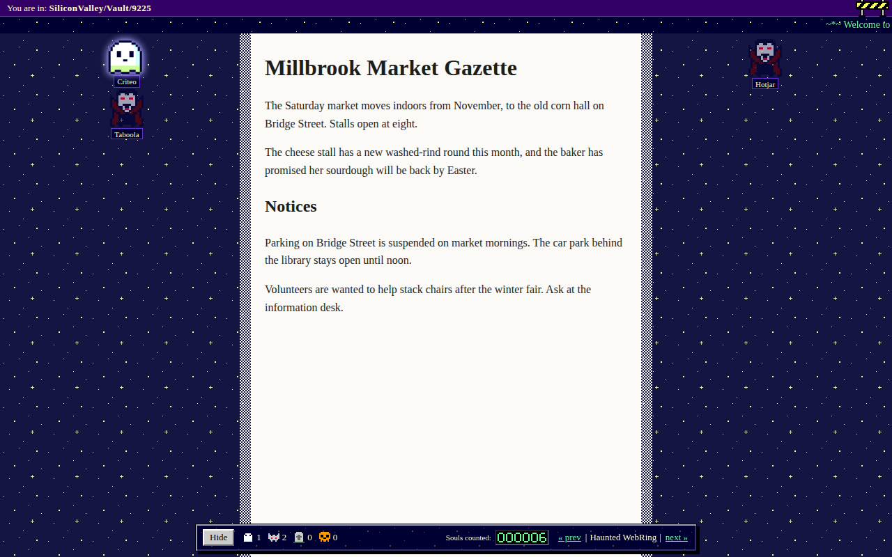
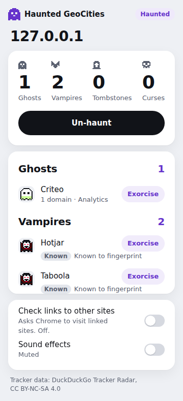
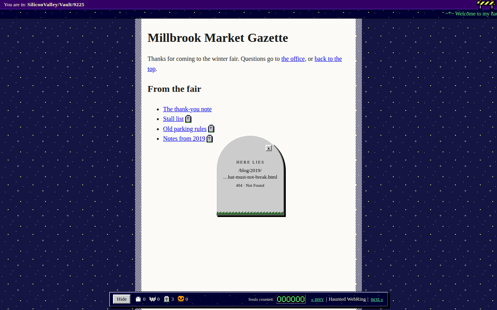

# Haunted GeoCities

A Chrome extension (Manifest V3) that turns the page you are on into a 1998 GeoCities crypt. Click **Haunt** and the page gets a night sky, a heads-up display and a marquee. Click **Un-haunt** and the page is put back as it was. It is an entry in Kiroween 2026, Costume Contest.

A pre-period prototype exists outside the entry and was rebuilt from lessons, not copied; Tracker Radar ingest output is the only reused data.



## What it does

- Haunt and un-haunt any page from the toolbar popup. The costume (starfield, HUD, marquee) sits in a closed shadow root over the page, and un-haunting removes it.
- Trackers show up as ghosts, one per company, matched against the bundled DuckDuckGo Tracker Radar data. Click a ghost for its card.
- Exorcise blocks a company for the current tab with declarativeNetRequest session rules. The block lasts until you un-haunt, reload or leave the page, or close the tab, and the popup can let it back in.
- Scripts caught fingerprinting at runtime (canvas, audio or font probing) become vampires. Companies that Tracker Radar already rates as fingerprinters are listed as known vampires.
- Dead links get a tombstone beside them. The extension sends a HEAD request, and a 404 or 410 answer makes a tombstone. Clicking one opens a stone card with the path and the status.
- The popup lists the ghosts, vampires and tombstones found on the page.

Dark-pattern curses, per-host neighborhoods and Kiro hooks are still to come.





## Load it

You need [bun](https://bun.sh) and Chrome.

```
bun install
bun run build
```

Open `chrome://extensions`, turn on Developer mode, choose **Load unpacked** and pick the `dist/` folder.

To load the packaged build instead, run `bun run package`. It builds and writes `dist.zip` at the repo root with `manifest.json` at the top of the zip. Unzip it into an empty folder and load that folder with **Load unpacked**.

Open a page and click the toolbar icon, then **Haunt this page**.

## Fixtures walkthrough

The fixture pages are small made-up sites in `fixtures/`. Start the server:

```
bun run fixtures
```

It serves them on `http://127.0.0.1:4321` (`scripts/fixture-server.ts`, an optional port can be passed as an argument).

| Page | What it shows |
| --- | --- |
| `index.html` | A plain newspaper page with a form and links. Haunt it and un-haunt it. |
| `clean.html` | A quiet page with no trackers. |
| `column.html` | A long article, good for seeing the costume around a page. |
| `trackers.html` | Ghosts (Criteo), plus Hotjar and Taboola as known vampires. Try Exorcise on the card or in the popup. |
| `vampires.html` | Two scripts that fingerprint the visitor when you click into the email field. After that they show up as caught vampires. |
| `links.html` | Three dead links (404, 410 and a long path) that get tombstones. |
| `forms.html` | Page scripts and a form that haunting must leave alone. |

The tracker and vampire pages load scripts from real tracker domains. Chrome has to send those names to the local server, so start a separate Chrome with a host-resolver flag, and load the extension in that one:

```
google-chrome --user-data-dir=/tmp/hg-profile --host-resolver-rules="MAP criteo.com 127.0.0.1,MAP hotjar.com 127.0.0.1,MAP taboola.com 127.0.0.1,MAP adentifi.com 127.0.0.1,MAP nightowl-metrics.test 127.0.0.1"
```

`index.html`, `clean.html`, `column.html`, `links.html` and `forms.html` work in any Chrome. The tracker and vampire pages need the flag, because otherwise the tracker hosts do not resolve and nothing is seen.

## Permissions

From `src/manifest.ts`:

- `activeTab`: lets the popup act on the tab you clicked in, and only that tab.
- `scripting`: injects the costume script into that tab when you click Haunt.
- `declarativeNetRequest`: Exorcise, which blocks a tracker company's domains for one tab.
- `storage`: keeps per-tab state for the session and the sound setting.
- Optional `http://*/*` and `https://*/*`: asked for only if you switch on "Check links to other sites" in the popup. Without it, only links on the same site are checked. You can turn it off again, which removes the permission.

There are no host permissions at install.

Privacy: link checks are sent with no cookies (`credentials: "omit"`). Nothing leaves the browser beyond those link checks. The tracker data is bundled in the extension and matched locally.

## Tracker Radar data and licence

The code is MIT (see [LICENSE](LICENSE)). The bundled `src/data/trackers.json` is derived from the DuckDuckGo Tracker Radar and is licensed CC BY-NC-SA 4.0, not MIT. If you reuse that data you have to keep the attribution, stay non-commercial and share it alike. See [src/data/ATTRIBUTION.md](src/data/ATTRIBUTION.md) and [src/data/LICENSE-tracker-radar.txt](src/data/LICENSE-tracker-radar.txt). The licence does not cover DuckDuckGo logos or marks.

## Notes

- The costume uses Comic Sans. On Linux it is usually not installed, so the browser falls back to another font.

## Checks

```
bun run typecheck
bun run test
bun run test:e2e
bun run docker:test
```

`test:e2e` launches headless Chromium with a build of the extension that also has host permissions for localhost (`dist-e2e/`), because Playwright cannot click the toolbar icon. `dist/`, the build you ship, has none. `docker:test` builds the Dockerfile, which runs the typecheck, the unit tests and the e2e run in a clean Playwright image.

The screenshots above are taken from the real extension on the fixtures by `bun run screenshots`, which is kept out of `test:e2e`.

## How Kiro was used

The `.kiro/` folder holds what kiro-cli generated for this project: steering files in `.kiro/steering/` (product, structure, tech, era accuracy, accessibility and motion, non-destructive DOM) and specs in `.kiro/specs/` for the scaffold, tracker detector, costume renderer, tombstones and runtime vampires. Each spec has requirements, a design and a task list.